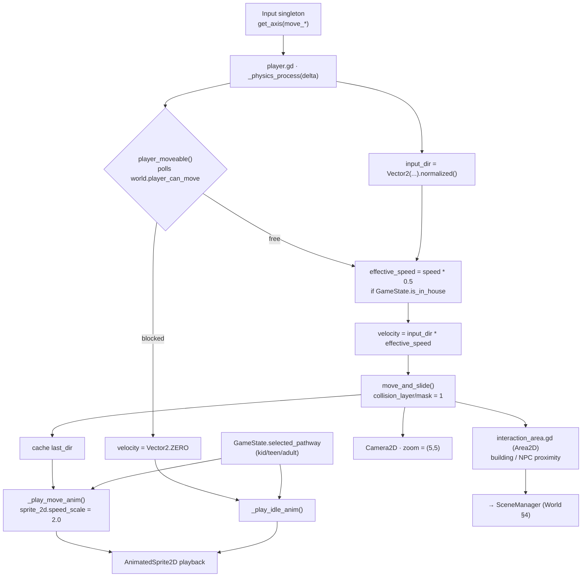
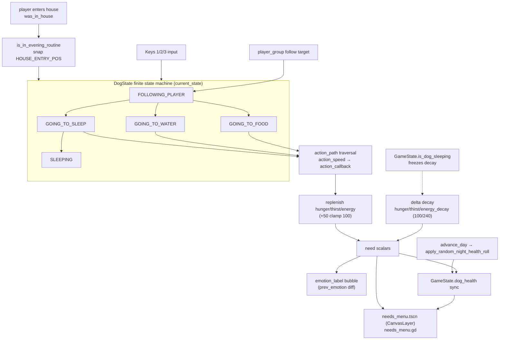
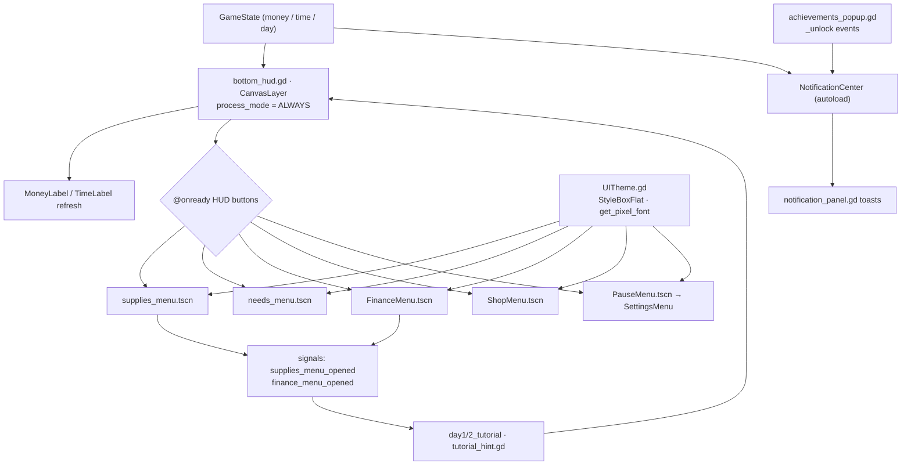
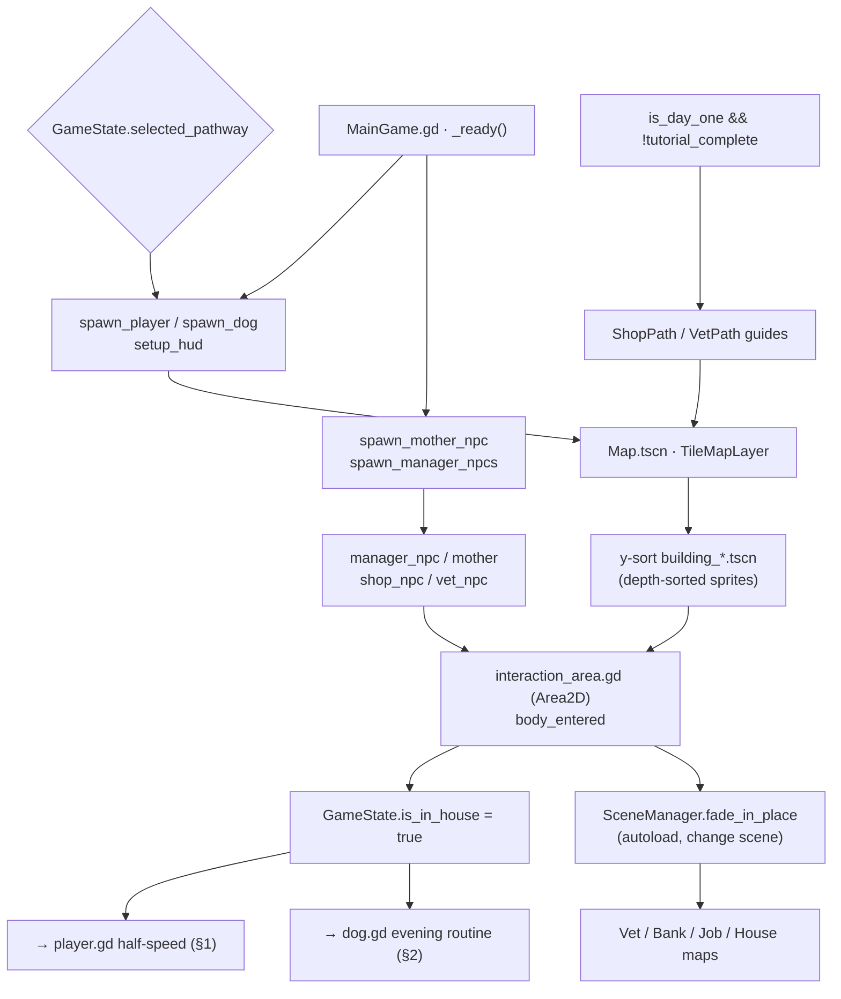
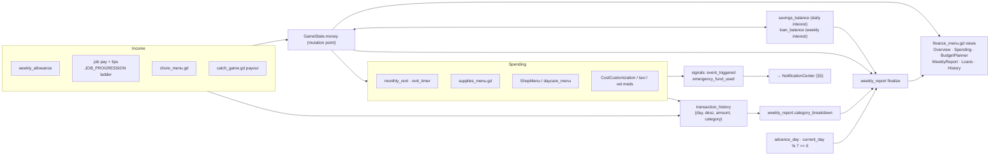
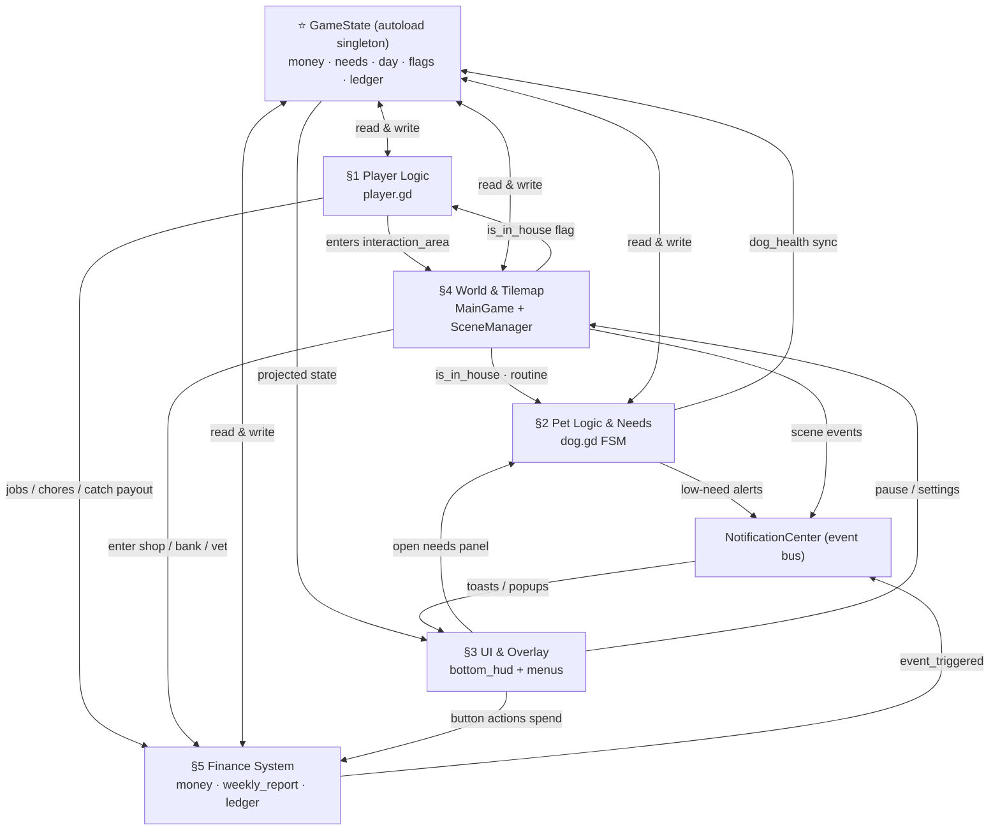

# My Little Buddy — System Architecture

High-level architecture for the four core subsystems, the finance data flow, and a
master integration diagram. Node labels reference the real scripts, scenes, signals,
and `GameState` fields in the codebase. The `GameState` autoload singleton
(`scripts/GameState.gd`) is the authoritative shared-state store; every subsystem
reads from and mutates it, and decoupled `signal` emissions act as the event bus.

---

## 1. Player Logic

The player is a `CharacterBody2D` sampled every physics tick. Input is read through
the `Input` singleton, normalized into a direction vector, scaled by a context speed,
and resolved against the collision world via `move_and_slide()`. Movement is gated by
the world's traversal flag and slowed indoors; the active pathway selects the
`AnimatedSprite2D` clip set.

---

## 2. Pet Logic & Pet Needs

`dog.gd` is an enum-driven finite state machine. It either path-follows the player
group or traverses a precomputed `action_path` toward fixed food/water/sleep targets,
firing an `action_callback` on arrival. Three need scalars decay by delta-time each
frame, replenish on actions, sync into `GameState.dog_health`, and drive both the
emotion bubble and the `needs_menu` overlay. House entry triggers a scripted evening
routine; nightly advance applies a random health roll.

---

## 3. UI & Overlay

`bottom_hud.gd` is a persistent `CanvasLayer` that processes while paused. Its
`@onready` buttons lazily instantiate preloaded menu `PackedScene`s as stacked
`CanvasLayer` overlays, and emit decoupled signals (`supplies_menu_opened`,
`finance_menu_opened`) consumed by the tutorial controllers. All menus pull styling
from `UITheme.gd` helpers (`StyleBoxFlat`, `get_pixel_font`). The `NotificationCenter`
autoload broadcasts toasts; `achievements_popup` raises unlock events.

---

## 4. World & Tile Map

`MainGame.gd` is the world bootstrap: it spawns the player, dog, HUD, and NPC actors
onto the `Map.tscn` `TileMapLayer`, branching spawn points by pathway. Buildings are
`y-sort` scenes whose `interaction_area` (`Area2D`) zones detect `body_entered`,
toggle the `GameState.is_in_house` flag, and request a `SceneManager` cross-fade into
interior maps (Vet, Bank, Job, House). Tutorial path guides overlay the tilemap on
Day 1.

---

## 5. Finance Flow

Income sources mutate `GameState.money`; spending sinks draw it down. The setter logs
each event into `transaction_history` with a category, which aggregates into the
`weekly_report.category_breakdown`. `advance_day` ticks `current_day`; every 7th day
finalizes the report. Savings accrue daily interest and loans accrue weekly interest.
`finance_menu.gd` renders the aggregated state across its six views, and balance events
fan out through signals.

---

## 6. Master Integration — Everything Connected

`GameState` is the central hub and `NotificationCenter` the event bus. Player traversal
drives world interaction; the world toggles flags the player and pet react to; gameplay
actions mutate the finance ledger; and the UI overlay projects every subsystem's state
back to the screen. No subsystem is isolated — all converge on shared state.

---

### Subsystem reference

| Subsystem | Entry point | Authoritative shared state |
| --- | --- | --- |
| Player | `scripts/player.gd` | `is_in_house`, `selected_pathway` |
| Pet | `scripts/dog.gd` | `dog_health`, `is_dog_sleeping` |
| UI | `scripts/bottom_hud.gd` | reads the full `GameState` surface |
| World | `scripts/MainGame.gd` + `SceneManager` | `is_in_house`, spawn / day flags |
| Finance | `scripts/GameState.gd` + `scripts/finance_menu.gd` | `money`, `weekly_report`, `transaction_history` |
| Event bus | `scripts/NotificationCenter.gd` | `event_triggered`, `emergency_fund_used` |
